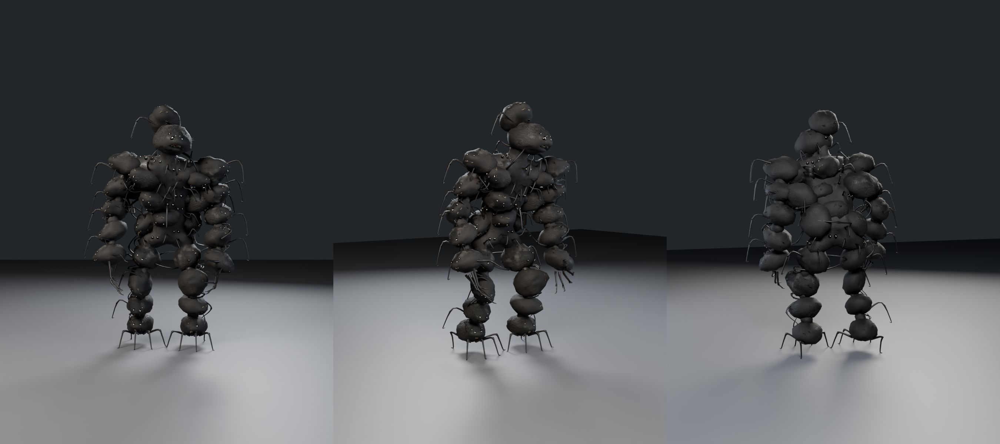
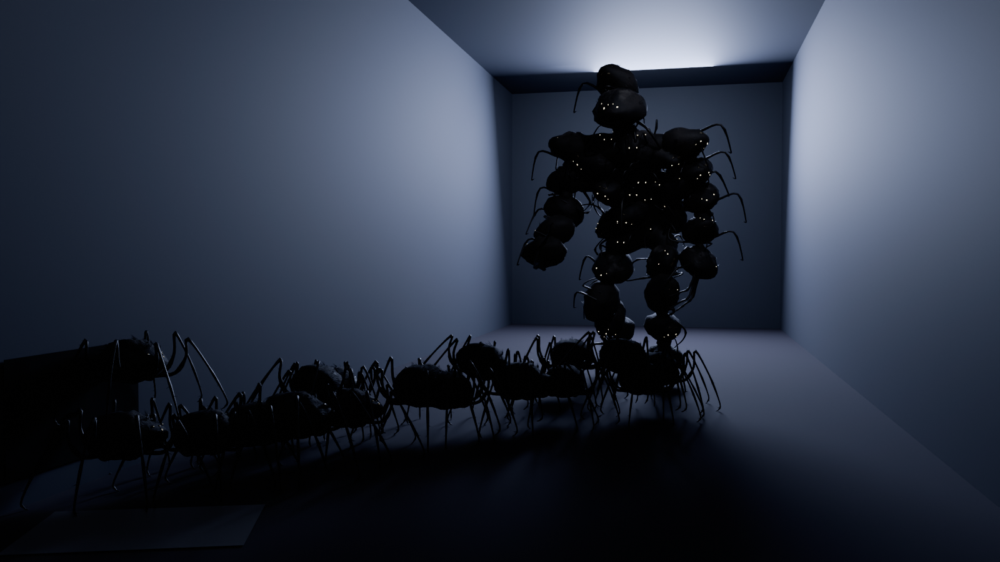

# The Litter

A swarm monster for REM CYCLE: dozens of knee-high black creatures that pour out of the air
vents, and the hunched, 9 ft monster they make when 30 of them climb onto each other. Built
procedurally in Blender 5.2 (`bpy`), rigged and animated for Roblox (Idle, Walk, Run for both
the stack and a single litterling).





## Look

**A litterling** (`renders/litterling_*.png`) is about 0.4 m long, knee-high to a player:

- **Body:** a lumpy, sagging, tick-like body, with a narrower head end, a pinched waist and a
  bloated back with soft folds across it. The skin is black and leathery and wrinkled where
  it's bare. Elsewhere it's covered in coarse, matted hair combed back along the body, in
  clumps of bristles, with greasy wet patches and vent dust and lint caught on top.
- **Eyes:** six wet black eyes sunk into fleshy sockets: two big ones and four small ones
  clustered round them. Each has a pale eyeshine glint, on its own part, which can glow in the
  dark like an animal's.
- **Mouth:** a wide, lipless slit under the eyes, dark red and wet inside, with two rows of
  yellowed needle teeth that interlock and longer fangs near the corners.
- **Legs:** eight thin, jointed, hairy legs, which leave the body low on its sides, rise to
  knees above the body and end in hooked claws.

**The stack** (`renders/stack_*.png`) is 30 of them climbed onto each other into one hunched
monster, about 2.7 m (9 ft) tall:

- **Body:** a barrel torso of ten creatures, a head of two, and arms and legs that are chains
  of them. They cling at every angle, some on their sides and some upside down, and hook their
  legs into each other.
- **The mass:** inside, the ones packed in the middle are crushed into a lumpy mass of bodies
  that the others sink half into. Legs jut out of it, and pairs of eyes peer out between the
  creatures clinging on. That's what makes it read as one monster rather than a pile of
  balls.
- **Head:** its face is a creature with its mouth hanging open, and a second one clings on
  behind and above it, peering over.
- **Hands and feet:** the creature at the end of each arm spreads its legs out as five long,
  clawed fingers (`renders/stack_hand.png`), and the creature at the bottom of each leg
  splays its legs on the floor as toes.

The whole swarm shares one texture set: every creature is built on the same UV layout, so the
stack's creatures reuse the litterling's maps. Only the inner mass has its own.

## Files

| Path | What it is |
|---|---|
| `export/Stack.fbx` | The rigged stack for Roblox's 3D Importer: 7.8 studs tall, origin at the pelvis, textures embedded |
| `export/Stack_Idle.fbx`, `_Walk.fbx`, `_Run.fbx` | The stack's animations, one each, for the Animation Editor's FBX import |
| `export/Stack.glb` | The stack as glTF, with all three animations |
| `export/Stack_Roblox.blend` | The 7.8-stud stack with its actions, for exporting animations with a Roblox plugin |
| `export/Litterling.fbx`, `Litterling_Idle.fbx`, `_Walk.fbx`, `_Run.fbx`, `Litterling.glb`, `Litterling_Roblox.blend` | The same for one litterling, at the same scale (1.2 studs tall) |
| `stack.blend`, `litterling.blend` | Blender sources at real-world size, with rigs, weights, materials and animations (textures packed) |
| `textures/roblox/` | The maps for SurfaceAppearance, all 1024 px |
| `renders/` | Previews: the stack (`stack_*`), a litterling (`litterling_*`), and `swarm` (the stack in a dark hallway, litterlings pouring out of a vent toward it) |
| `renders/animations/` | Preview videos of the stack's animations, and the litterling's in `litterling/` |
| `src/` | Scripts that generate all of the above |

## Parts and budget

**Litterling**

| MeshPart | Triangles | Roblox setup |
|---|---|---|
| Body (body, legs, eyes, mouth, teeth, hair) | 4,339 | SurfaceAppearance `litterling_body_*` |
| Eyeshine | 192 | Neon, pale yellow (see In the game) |
| **Total** | **4,531** | |

**Stack**

| MeshPart | Triangles | Roblox setup |
|---|---|---|
| StackTorso1 / StackTorso2 (5 creatures each) | 7,688 / 8,406 | `litterling_body_*` |
| StackHead | 3,105 | `litterling_body_*` |
| StackArmL / StackArmR (with the fingers) | 9,367 / 9,373 | `litterling_body_*` |
| StackLegL / StackLegR (with the toes) | 6,557 / 6,983 | `litterling_body_*` |
| StackCrush (the legs and eyes in the mass) | 5,914 | `litterling_body_*` |
| StackMass | 2,992 | `stack_mass_*` |
| StackEyeshine | 5,280 | Neon, pale yellow |
| **Total** | **65,665** | |

Each SurfaceAppearance takes the four maps with that prefix: `_color` as ColorMap, `_normal`
as NormalMap, `_roughness` as RoughnessMap and `_metalness` as MetalnessMap. Each mesh is
under 10k triangles and has at most 3 bone weights per vertex.

The stack is heavy, like the Receiver, because each of its 30 creatures is real geometry with
its own eyes, teeth, hair and legs. Only one stack is ever on screen, so that should be fine.
**Cap the loose litterlings at about 30** (4.5k triangles each). If that's too heavy on
mobile, cheaper litterlings are possible with fewer legs' segments and less hair.

## Importing into Roblox Studio

1. Open the 3D Importer (**Import 3D**) and choose `export/Stack.fbx`, then
   `export/Litterling.fbx`.
2. **Size:** the stack is 7.8 studs tall and a litterling 1.2 studs, the same scale as the
   other monsters (8 studs for 9 ft), so a litterling is knee-high next to a player. Use
   `Model:ScaleTo()` to adjust both together.
3. **Standing on the floor:** each rig's root is where Roblox puts the HumanoidRootPart: the
   stack's pelvis, 3.6 studs above the floor, and the litterling's body, 0.76 studs up. If
   the feet don't touch the ground, set the Humanoid's HipHeight. Run this once in the
   command bar with the model selected:

   ```lua
   local m = game.Selection:Get()[1]
   local hum = m:FindFirstChildOfClass("Humanoid")
   local root = hum.RootPart or m:FindFirstChild("HumanoidRootPart")
   local cf, size = m:GetBoundingBox()
   hum.HipHeight = (root.Position.Y - root.Size.Y / 2) - (cf.Position.Y - size.Y / 2)
   print("HipHeight", hum.HipHeight)
   ```

   For the litterlings, an `AnimationController` with an `Animator` (and moving them with
   your own scripts) is lighter than 30 Humanoids.
4. **Facing:** both are exported with −Z forward. If one faces away, rotate it 180°.
5. **Textures:** upload the PNGs in `textures/roblox/` and add a SurfaceAppearance to each part
   as in the tables above. Leave the Eyeshine parts without one.

## In the game

- **Eyeshine:** set `Eyeshine` and `StackEyeshine` to Neon, a pale yellow
  (`Color3.fromRGB(255, 236, 190)`). In a dark hallway the swarm's eyes then glint back at the
  player (as in `renders/swarm.png`). Turn them darker or off when the creatures are
  meant to be still and hidden.
- **Climbing into the stack:** the stack has a bone for each creature, `Slot_Torso1` to
  `Slot_Torso10`, `Slot_Head1` and `Slot_Head2`, `Slot_LeftArm1` to `5` and `Slot_RightArm1`
  to `5` (5 is the hand), and `Slot_LeftLeg1` to `4` and `Slot_RightLeg1` to `4` (4 is the
  foot). Each sits at its creature's centre and moves with it. To have the swarm form the
  stack, keep the stack hidden, send each litterling scurrying to a slot, and swap them for
  the stack once they're all there:

  ```lua
  local TweenService = game:GetService("TweenService")

  -- Climbs the litterlings into the stack, then shows the stack in their place.
  local function formStack(stack: Model, litterlings: { Model }, climbTime: number)
      local slots = {}
      for _, d in stack:GetDescendants() do
          if d:IsA("Bone") and string.sub(d.Name, 1, 5) == "Slot_" then
              table.insert(slots, d)
          end
      end
      table.sort(slots, function(a, b) -- the feet first, the head last
          return a.WorldPosition.Y < b.WorldPosition.Y
      end)
      local parts = {}
      for _, p in stack:GetDescendants() do
          if p:IsA("MeshPart") then
              parts[p] = p.Transparency
              p.Transparency = 1
          end
      end
      for i, ling in litterlings do
          local slot = slots[i]
          if not slot then
              ling:Destroy()
              continue
          end
          local cf = Instance.new("CFrameValue")
          cf.Value = ling:GetPivot()
          cf.Changed:Connect(function(v)
              ling:PivotTo(v)
          end)
          local delay = (i - 1) / #slots * climbTime * 0.5 -- they climb on one after another
          local tween = TweenService:Create(cf, TweenInfo.new(climbTime * 0.5, Enum.EasingStyle.Quad,
              Enum.EasingDirection.Out, 0, false, delay), { Value = slot.TransformedWorldCFrame })
          tween.Completed:Once(function()
              cf:Destroy()
              ling:Destroy()
          end)
          tween:Play()
      end
      task.wait(climbTime)
      for p, t in parts do
          p.Transparency = t
      end
  end
  ```

  The litterlings end up turned the way their slots are, some on their sides and upside down,
  as they cling in the stack. If one ends up turned wrong, use
  `CFrame.new(slot.TransformedWorldCFrame.Position)` instead to move them without turning
  them. To break the stack back apart, do the reverse: hide the stack and spawn a litterling
  at each slot's `TransformedWorldCFrame`. I haven't been able to test this in Studio.
- **Coming out of the vents:** spawn litterlings just inside a vent and play `Run`. A
  litterling is 1.2 studs tall and about 2.4 studs across its legs, so a vent opening of
  about 1.5 by 2.5 studs fits them.

## Animations

All six are in place (the Humanoid or your script does the moving), 30 fps, keyed on every
frame, and loop seamlessly (the last frame equals the first). Legs were solved with IK while
animating so planted feet don't slide, then written out as plain rotation keys, so nothing
needs a constraint or a special exporter.

**The stack** is always heaving: every creature in it keeps shifting and looking about on its
slot, a few turn right round, and each footstep sends a wobble up through the creatures, the
higher ones later.

| Action | Length | Loop | Feel |
|---|---|---|---|
| `Idle` | 120 frames (4 s) | yes | Hunched and heaving, two slow breaths; the head turns slowly, looking about; the finger legs flex; the creatures fidget and look round |
| `Walk` | 40 frames (1.33 s) | yes | A heavy, hunched lumber with flat-footed steps; the arms swing low; each step wobbles up the stack |
| `Run` | 22 frames (0.73 s) | yes | A scrambling charge leaning in, head down, the arms reaching forward and the finger claws opening at the front of each swing; heavy steps that shake the whole stack |

**The litterling:**

| Action | Length | Loop | Feel |
|---|---|---|---|
| `Idle` | 120 frames (4 s) | yes | Still and breathing, turning to look about; a front leg taps the floor twice, then it rears up with its front legs raised and feeling the air, and settles |
| `Walk` | 16 frames (0.53 s) | yes | A scuttle on an alternating gait, like a spider's: four legs step together (left 1 and 3, right 2 and 4), then the other four |
| `Run` | 8 frames (0.27 s) | yes | The same gait, fast and low, leaning in |

**Matching speed:** the feet are matched to these ground speeds. At other speeds, scale the
track speed to match, for example `track:AdjustSpeed(humanoid.WalkSpeed / 13.4)` for the
stack's run.

- **Stack walk:** 3.2 studs/s
- **Stack run:** 13.4 studs/s
- **Litterling walk:** 1.7 studs/s
- **Litterling run:** 8.2 studs/s

**Exporting them yourself:** open `export/Stack_Roblox.blend` or
`export/Litterling_Roblox.blend`. They match the models you imported. Pick an action on
`Stack_Rig` or `Litterling_Rig` and export it with your plugin. Only `LowerTorso` (the stack)
and `Body` (the litterling) have translation keys; every other bone is rotation only.

## Rig

**Stack:** 67 bones.

- **Root:** `Root` → `HumanoidRootNode` → `LowerTorso`, all at the pelvis, the bone layout
  Roblox uses for skinned characters.
- **Body:** `LowerTorso` → `UpperTorso` → `Head`.
- **Arms:** `UpperTorso` → `Left/RightUpperArm` → `LowerArm` → `Hand` → `Thumb`, `Index`,
  `Middle`, `Ring` and `Pinky`, each `1` and `2` (the hand creature's legs).
- **Legs:** `LowerTorso` → `Left/RightUpperLeg` → `LowerLeg` → `Foot`.
- **Slots:** a `Slot_` bone for each of the 30 creatures, parented to the body bone it rides
  on. Each creature is rigid on its slot, so it can shift and turn on its own.

How the parts follow the bones:

- **Creatures:** rigid on their slots. The legs they hook into their neighbours blend from
  their own slot to the neighbour's, so they stretch rather than tear as the stack moves.
- **Fingers and toes:** the hand creature's legs follow the finger bones; the foot creature's
  legs are rigid on its slot.
- **The mass and what juts out of it:** blend between the nearest body and limb bones.

**Litterling:** 18 bones. `Root` (at the body's height) → `Body` → `Leg{L|R}{1-4}A` (hip to
knee) → `Leg{L|R}{1-4}B` (knee to claw). Leg 1 is the front pair and leg 4 the back.

## Rebuilding

Needs `pip install bpy` (Blender as a Python module), Pillow and ffmpeg. The scripts reuse
helpers from `../poster_monster/src`, `../props/src` and `../shared`. Run from `src/`:

```bash
python3 litter_build.py ..                     # both models, rigs, weights and baked textures (--only litterling|stack)
python3 litter_animate.py ..                   # keyframe Idle, Walk and Run for both (--only stack|litterling)
python3 litter_render.py .. ../renders --shots stack_front,stack_three,stack_back   # previews (also stack_side, stack_head, stack_hand, litterling_close, litterling_face, litterling_side, swarm)
python3 litter_export.py .. ../export          # FBX (model + one per animation), GLB, Roblox .blend and textures/roblox

# from art/: a contact sheet and preview videos of the animations
python3 shared/anim_sheet.py litter/stack.blend Stack_Rig sheet.png --target 0,0,1.25 --offset=-5.5,-4.5,0.3
python3 shared/anim_preview.py litter/stack.blend Stack_Rig litter/renders/animations --target 0,0,1.25 --offset=-5.5,-4.5,0.3 --lens 50
python3 shared/anim_preview.py litter/litterling.blend Litterling_Rig litter/renders/animations/litterling --target 0,0,0.22 --offset=-1.1,-1.0,0.45 --lens 50 --res 600x480
```

Rebuild the litterling before the stack: the stack reuses the litterling's baked maps.
Everything is seeded, so a rebuild gives the same swarm.

- **Litterling proportions, leg layout, the stack's skeleton and where each creature sits:** `litter_common.py`
- **The creature's body, skin, eyes, mouth, hair and legs, the stack's mass, and the rigs:** `litter_build.py`
- **The animations:** `litter_animate.py`, using the shared tools in `../shared/anim_core.py`
