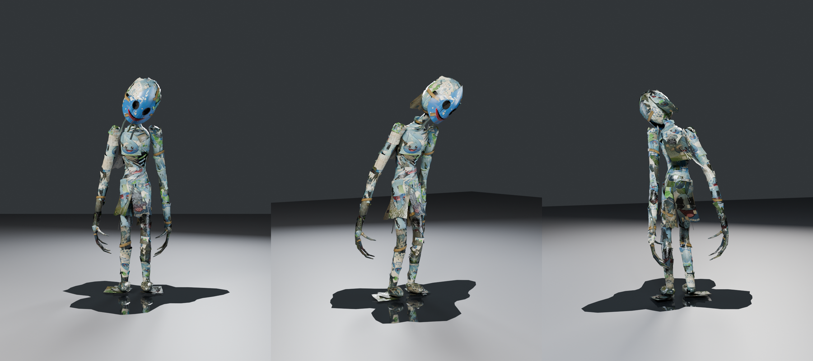

# Poster Monster (floor 1)

The floor-1 monster for REM CYCLE: a 9 ft figure covered in the building's soaked promo
posters, wearing a cracked plastic mask of the company's droplet mascot. Built procedurally
in Blender 5.2 (`bpy`), rigged and animated for Roblox (Idle, Walk, Run).



## Look

- **Body:** gaunt, with a pinched waist, a long thin neck, and arms long enough that the
  rolled-poster claws hang past the knees. Underneath is one merged papier-mâché body, so the
  arms, legs, neck and head grow out of the torso.
- **Posters:** whole, upright promo posters glued on in overlapping rows, each row over the one
  below like shingles. They're water-damaged, with tide-line stains, running ink, mold and fold
  cracks. The lower body is the most soaked, and a couple of sheets are missing so the dark pulp
  shows.
- **Loose sheets:** six posters peel away from the body, each with an older poster underneath.
  They sit on the hip, back, chest, left upper arm, left shin and right thigh, and each has two
  bones so it can flutter.
- **Chest:** torn open on the front-left, with three rolled-poster ribs hanging off a
  rolled-poster sternum. The far ends of the ribs tuck under the posters.
- **Mask:**
  - It sits crooked, taped onto a balled-up head of posters.
  - The eye holes are deep, empty sockets with black streaks running from them.
  - The painted grin is knife-cut open, with paint dripping from it.
  - It's cracked through, and one piece is bent out with a chunk missing.
  - Strings of wet paper hang from under it.

## Files

| Path | What it is |
|---|---|
| `export/PosterMonster.fbx` | Rigged model for Roblox's 3D Importer: 8 studs tall, origin at the pelvis, textures embedded |
| `export/PosterMonster_Roblox.blend` | The same 8-stud model and rig with the Idle, Walk and Run actions, for exporting the animations with a Roblox plugin |
| `export/PosterMonster_Idle.fbx`, `_Walk.fbx`, `_Run.fbx` | One animation each, for the Animation Editor's FBX import |
| `export/PosterMonster.glb` | Same model as glTF, with 1024 px PBR textures and all three animations |
| `poster_monster.blend` | Blender source at real-world size (2.71 m), with rig, weights, materials and animations (textures packed) |
| `renders/animations/` | Preview videos of the three animations |
| `textures/roblox/` | 1024 px maps for SurfaceAppearance (color, normal, roughness) |
| `textures/` | 2048 px authoring maps, plus `posters_clean_sheet.png` (undamaged poster art, usable as decals) |
| `renders/` | Previews: `rest_*` is the pose Studio shows, `idle_*` a hunched pose. `rig_range_of_motion.png` is the deformation test |
| `src/` | Scripts that generate all of the above |

## Budget

| MeshPart | Triangles | Material |
|---|---|---|
| Body_Core | 5,200 | paper atlas (the pulp body) |
| Body_Upper | 8,092 | paper atlas |
| Body_Lower | 4,012 | paper atlas |
| Body_Hands | 2,352 | paper atlas |
| Mask | 1,517 | mask |
| EyeGlow | 128 | plain (no texture) |
| **Total** | **21,301** | |

Each mesh is under 10k triangles. The skin has 63 bones and at most 4 bone weights per vertex.

## Importing into Roblox Studio

1. Open the 3D Importer (**Import 3D**) and choose `export/PosterMonster.fbx`.
2. **Size:** the file is 8 studs tall, about 1.5× a default avatar (9 ft next to a 6 ft
   explorer). Use `Model:ScaleTo()` to adjust, or re-export with another height (see
   Rebuilding).
3. **Standing on the floor:** the rig's root is at the pelvis, 3.8 studs above the feet, so
   the HumanoidRootPart should land inside the hips. If the model has a Humanoid, set its
   HipHeight so the feet touch the ground. Run this once in the command bar with the model
   selected:

   ```lua
   local m = game.Selection:Get()[1]
   local hum = m:FindFirstChildOfClass("Humanoid")
   local root = hum.RootPart or m:FindFirstChild("HumanoidRootPart")
   local cf, size = m:GetBoundingBox()
   hum.HipHeight = (root.Position.Y - root.Size.Y / 2) - (cf.Position.Y - size.Y / 2)
   print("HipHeight", hum.HipHeight)
   ```
4. **Facing:** it is exported with −Z forward, Roblox's forward direction. If it faces away,
   rotate it 180°.
5. **Textures:** upload the six PNGs in `textures/roblox/`, then add a `SurfaceAppearance` to
   each MeshPart:
   - `Body_Core`, `Body_Upper`, `Body_Lower`, `Body_Hands`: ColorMap `paper_color`, NormalMap
     `paper_normal`, RoughnessMap `paper_roughness`
   - `Mask`: `mask_color`, `mask_normal`, `mask_roughness`
6. **EyeGlow** is a tiny glint at the back of each eye socket. Delete it for completely black
   holes.
7. To play animations later, the Humanoid's `Animator` works. If you'd rather move the monster
   with your own scripts, use an `AnimationController` with an `Animator` instead.

## Animations

All three are in place (the Humanoid does the moving), 30 fps, keyed on every frame, and
loop seamlessly (the last frame equals the first). The legs were solved with IK while
animating so planted feet don't slide, then written out as plain rotation keys, so nothing
needs a constraint or a special exporter.

| Action | Length | Loop | Feel |
|---|---|---|---|
| `Idle` | 120 frames (4 s) | yes | Hunched and still with a slow sway; the head drifts slowly from side to side; fingers twitch, one shoulder shrugs, the peeling sheets flutter |
| `Walk` | 34 frames (1.13 s) | yes | A slow crouched stalk: light toe-first steps, arms dragging behind the body, the head held steady and tilted |
| `Run` | 20 frames (0.67 s) | yes | A predatory run leaning in, the shoulders counter-twisting and the arms swinging loosely like pendulums with relaxed elbows, claws easing open at the front of each swing; the elbow, wrist and fingers trail the upper arm so the swing stays smooth; the head stays locked ahead; light steps with a short float |

The steps are light on purpose (the monster is paper): toes land first, the body barely
dips, and the run floats between steps.

**Matching speed:** the feet are matched to these ground speeds. At other WalkSpeeds,
scale the track speed to match, for example
`track:AdjustSpeed(humanoid.WalkSpeed / 11.1)` for the run.

- **Walk:** 3.7 studs/s
- **Run:** 11.1 studs/s

**Exporting them yourself:** open `export/PosterMonster_Roblox.blend`. It matches the
model you imported (8 studs, origin at the pelvis). Pick an action on
`PosterMonster_Rig` and export it with your plugin. Only `LowerTorso` has translation keys
(the bob and sway); every other bone is rotation only.

## Rig

- **Root:** `Root` → `HumanoidRootNode` → `LowerTorso`, both at the pelvis, the bone layout
  Roblox uses for skinned characters.
- **Spine:** `LowerTorso` → `Spine` → `UpperTorso` → `Neck` → `Head`
- **Arms:** `Left/RightShoulder` → `UpperArm` → `LowerArm` → `Hand` → `Index`, `Middle`,
  `Ring`, `Pinky`, `Thumb` (each `1`–`3`)
- **Legs:** `Left/RightUpperLeg` → `LowerLeg` → `Foot`
- **Peeling sheets:** two bones each, `…1` and `…2`, on `PeelHip`, `PeelBack`, `PeelChest`,
  `PeelArmL`, `PeelShinL` and `PeelThighR`.

Names follow R15 where a matching bone exists.

## Rebuilding

Needs `pip install bpy` (Blender as a Python module), Pillow and numpy. Run from `src/`:

```bash
python3 textures.py ../textures                          # paint the textures
python3 build_model.py ../poster_monster.blend           # model, rig and weights
python3 render.py ../poster_monster.blend ../renders     # previews (--pose rest|idle, --look studio|atrium)
python3 rig_check.py ../poster_monster.blend ../renders/rig_range_of_motion.png
python3 animate.py ../poster_monster.blend               # keyframe Idle, Walk and Run
python3 anim_preview.py ../poster_monster.blend ../renders/animations   # preview videos
python3 export.py ../poster_monster.blend ../export      # FBX, GLB and Roblox .blend (--height-studs 8)
```

Everything is seeded, so a rebuild gives the same monster.

- **Proportions:** `skeleton.py`
- **Body surfaces and the chest hole:** `layout.py`
- **Mask:** `mask.py` and `common.py`
- **Poster layout:** `build_wrap` in `build_model.py`
