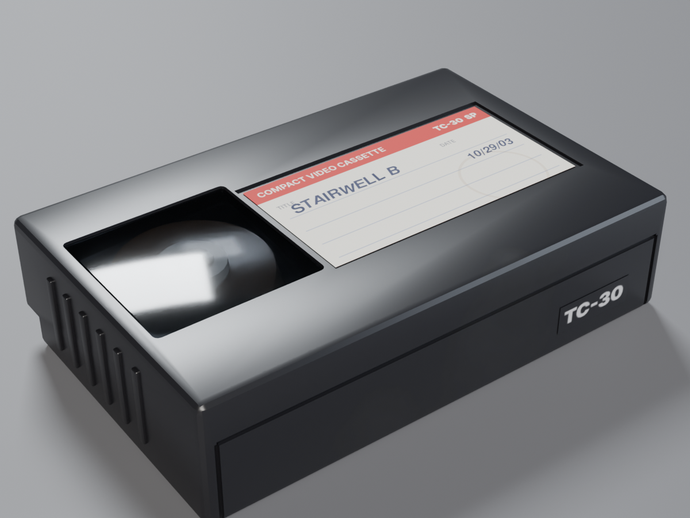
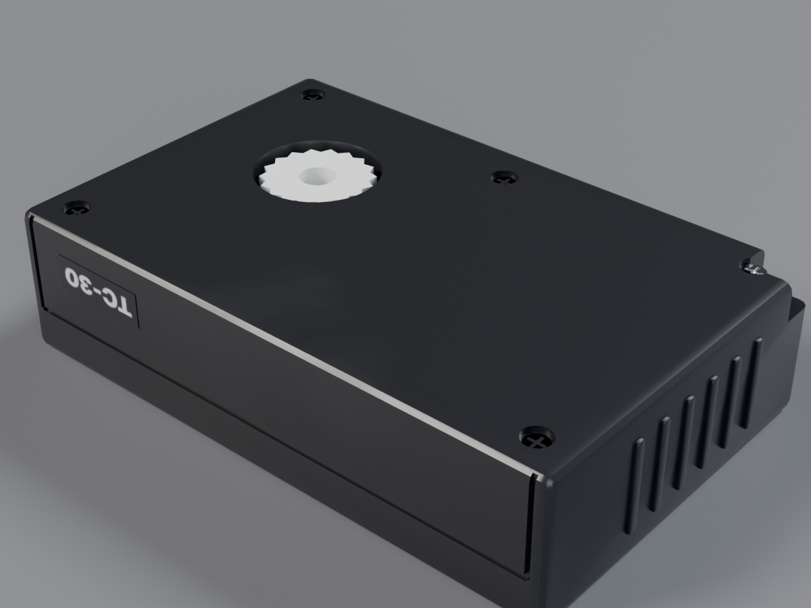
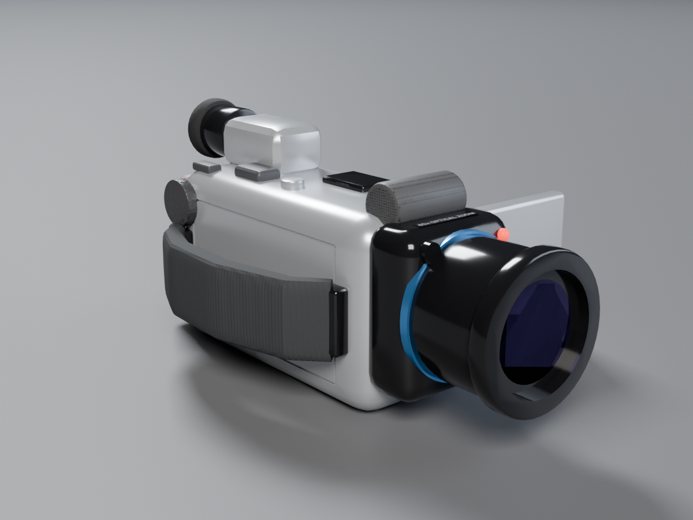
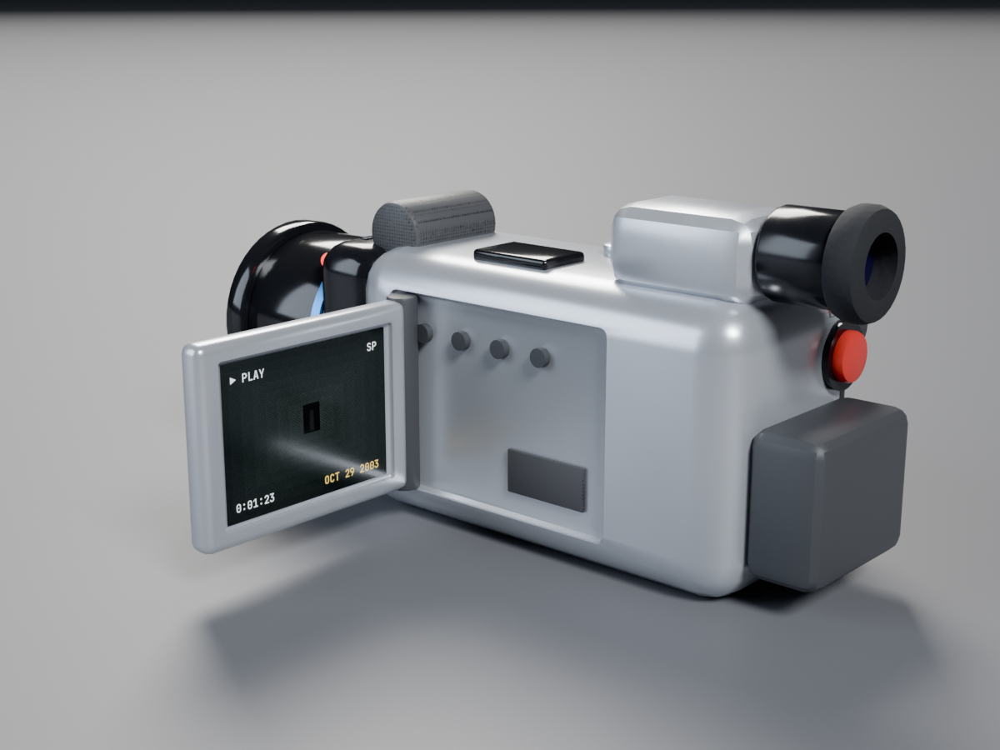
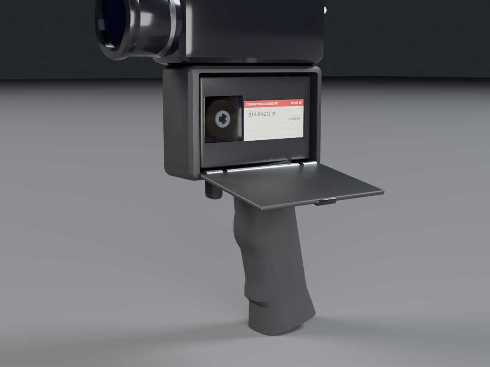
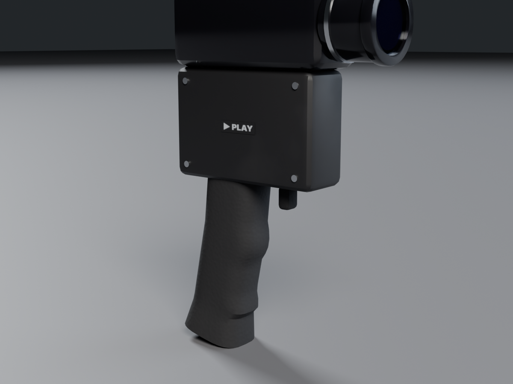

# Rewind props: tape, camcorder, tape player

Realistic props for REM CYCLE's Rewind mode, built in Blender 5.2 (`bpy`) at real size. Each
one's materials are baked into textures for Roblox's SurfaceAppearance.

| | |
|---|---|
|  |  |
|  |  |
|  |  |

## The props

- **Tape:** a compact camcorder cassette, the size of a VHS-C tape (92 × 59 × 23 mm), so the
  same tape fits the camcorder and the tape player. It's black plastic with:
  - a window onto the wound tape and its hub
  - the outline of the protective lid along the front
  - grip ridges on both ends
  - underneath: the reel's gear, five screws and the record-protect notch
  - a paper label, a separate part, so every lost tape can have its own. `label_stairwell.png`
    has "STAIRWELL B / 10/29/03" written on in marker. `label_blank.png` is unwritten, for
    the game to write on with a SurfaceGui.
- **Camcorder:** a 2000s handheld:
  - a silver body with a glossy black front and a blue accent ring round the lens
  - a fabric hand strap on the right side
  - a viewfinder with a rubber eyecup, a battery, a red REC button and a mode dial at the back
  - a zoom rocker and photo button on top, and a microphone grille on the front
  - the outline of the tape door on the right side
  - the flip-out screen opened on its left, showing playback (`screen_playback.png`: a dark
    hallway with ▶ PLAY, a timecode and the date stamp), and a separate red REC light on the
    front
- **Tape player:** a black rubber pistol grip with finger grooves and a play button where your
  finger rests. A small black video camera sits on top, and the cassette bay is under the
  camera. The bay has reel spindles and a capstan inside, and a door on the left side, hinged
  along its bottom edge, that swings down to open. A green light sits on the back of the
  camera. A tape fits the bay standing on its long edge, label facing out.

## Files

| Path | What it is |
|---|---|
| `export/Tape.fbx`, `export/Camcorder.fbx`, `export/TapePlayer.fbx` | For Roblox's 3D Importer, in studs, facing Roblox's forward (−Z), textures embedded |
| `export/*.glb` | The same as glTF |
| `tape.blend`, `camcorder.blend`, `tape_player.blend` | Blender sources at real size (meters) |
| `textures/roblox/` | Baked maps for SurfaceAppearance, plus the labels and the screen image |
| `renders/` | The previews above |
| `src/` | Scripts that generate all of it |

## Parts and budget

| Prop | MeshPart | Triangles | Roblox setup |
|---|---|---|---|
| Tape | Handle | 4,264 | SurfaceAppearance `tape_handle_*` |
| | Window | 188 | Glass, dark grey, Transparency 0.5 |
| | Label | 2 | TextureID `label_stairwell` or `label_blank` |
| Camcorder | Body | 7,164 | `camcorder_body_*` |
| | Handle (the hand strap) | 1,236 | `camcorder_handle_*` |
| | Panel (the flip-out screen) | 554 | `camcorder_panel_*` |
| | Screen | 2 | TextureID `screen_playback`, Material Neon or a SurfaceGui |
| | Lens | 156 | Glass, dark blue-grey |
| | RecLight | 224 | Neon, red (off: SmoothPlastic, dark red) |
| Tape player | Body (deck and camera) | 3,182 | `tape_player_body_*` |
| | Handle (the grip) | 1,396 | `tape_player_handle_*` |
| | Door | 1,000 | `tape_player_door_*` |
| | Lens | 124 | Glass, dark blue-grey |
| | Light | 224 | Neon, green |

Each SurfaceAppearance takes the four maps with that prefix: `_color` as ColorMap, `_normal`
as NormalMap, `_roughness` as RoughnessMap and `_metalness` as MetalnessMap.

## Importing into Roblox Studio

1. Import each `.fbx` with the 3D Importer. Each comes in as a model of the parts above.
2. **Size:** they're at real size, on the same scale as the monsters (2.92 studs to the
   meter):
   - the tape is 0.27 studs long
   - the camcorder is 0.71 studs long
   - the tape player is 0.71 studs tall

   That's true to life next to a 6 ft explorer. If you'd rather have chunkier gear, use
   `Model:ScaleTo(2)` before making the tools.
3. **Making a Tool:** the part a hand holds is always named `Handle`, so put the parts in a
   `Tool` and weld the rest to it. Run this in the command bar with the Tool selected:

   ```lua
   local tool = game.Selection:Get()[1]
   local handle = tool:FindFirstChild("Handle", true)
   for _, part in tool:GetDescendants() do
       if part:IsA("BasePart") then
           part.Anchored = false
           part.CanCollide = false
           if part ~= handle and part.Name ~= "Door" then
               local weld = Instance.new("WeldConstraint")
               weld.Part0, weld.Part1 = handle, part
               weld.Parent = part
           end
       end
   end
   handle.Parent = tool
   ```

   The lenses point along −Z, Roblox's forward. If a tool sits in the hand the wrong way
   round, turn it with `Tool.Grip`, for example `tool.Grip = CFrame.Angles(0, math.rad(180), 0)`.

### Opening the tape player's door

The door ships closed. Its hinge runs along its bottom edge, 0.093 studs below the door's
centre, and it opens by turning 100° about the Z axis. This sets it up on a Motor6D and
swings it (re-measure the hinge offset if you rescale the model):

```lua
local TweenService = game:GetService("TweenService")

-- Call once, with the door closed. Returns a function that opens or closes it.
local function setupDoor(tool: Tool)
    local body = tool:FindFirstChild("Body", true) :: BasePart
    local door = tool:FindFirstChild("Door", true) :: BasePart
    local hinge = door.CFrame * CFrame.new(0, -door.Size.Y / 2 + 0.008, 0)
    local motor = Instance.new("Motor6D")
    motor.Part0, motor.Part1 = body, door
    motor.C0 = body.CFrame:Inverse() * hinge
    motor.C1 = door.CFrame:Inverse() * hinge
    motor.Parent = door
    local closed = motor.C0
    return function(open: boolean)
        local goal = if open then closed * CFrame.Angles(0, 0, math.rad(100)) else closed
        TweenService:Create(motor, TweenInfo.new(0.35, Enum.EasingStyle.Quad), { C0 = goal }):Play()
    end
end
```

If the door swings into the deck instead of out, use `math.rad(-100)`. I haven't been able to
test this in Studio.

### Putting a tape in the bay

A tape sits with its centre 0.054 studs below and 0.062 studs forward of the Body's centre,
and 0.012 studs toward the door side. It stands on its long edge with its label facing out
through the door:

```lua
local function placeTape(player: Model, tape: Model)
    local body = player:FindFirstChild("Body", true) :: BasePart
    local pos = Vector3.new(-0.0117, -0.054, 0.062)
    local inBay = body.CFrame * CFrame.fromMatrix(pos, Vector3.new(0, 0, -1), Vector3.new(-1, 0, 0))
    tape:PivotTo(inBay)
end
```

The rotation here comes from how the exporter turns Blender's axes into Roblox's. If the tape
comes out lying the wrong way, turn it about the Body's axes until it stands in the bay.

## Rebuilding

Needs `pip install bpy` (Blender as a Python module) and Pillow. Run from `src/`:

```bash
python3 props_textures.py ../textures      # labels, the playback screen, printed markings
python3 props_build.py ..                  # model, bake and save all three (--only tape|camcorder|player)
python3 props_render.py .. ../renders      # previews
python3 props_export.py ..                 # FBX and GLB in studs, textures/roblox
```

Models and materials are in `props_build.py`; the modeling, material and baking helpers are in
`props_lib.py`.
