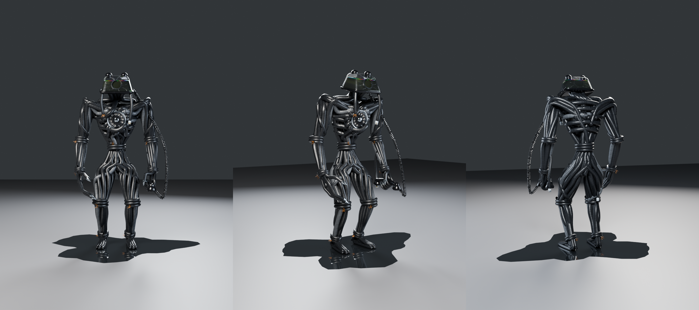

# The Receiver (floor 4)

The floor-4 monster for REM CYCLE: an 8 ft man made entirely of thick, tangled, coiled black
phone cord. His head is a smoked black glass phone full of dirty water, with its dial torn out
of the face and set into his chest like a heart. He carries his own handset. Built
procedurally in Blender 5.2 (`bpy`) and rigged for Roblox.



## Look

- **Cords:** thick coiled phone cord, about 6 cm across at his size, with the coil running
  round each cord as a helix. Most are black and a few are smoke grey. The coils are in the
  texture's normal map, so they catch the light without costing triangles.
- **Body:** the cords are laid like muscle, not just bundled:
  - ribs hoop round a barrel chest and dive under the dial's chrome ring
  - cords fan out of the dial over the chest, loop over the shoulders and run down the arms
  - the waist is narrow, twisted and bound with a cord
  - the bundles swell into shoulders, biceps, heavy forearms, thighs and calves, with a thick
    core cord inside each limb so no gaps show
  - cords wound diagonally round the upper arms, the thighs and across his back tangle it all
  - cords are bound round the elbows, wrists, knees and ankles, and the bindings end in torn
    copper wire
- **Pose:** hunched. His head hangs forward of his chest over a hump in his back. He has
  broad shoulders, a tiny waist and long arms bent at the elbow, with the forearms reaching
  forward. His knees are bent and bowed.
- **Head:** a black glass desk phone with an empty cradle (the two prongs on top):
  - It's about 70% full of murky water, with an oily rainbow film at the surface, bubbles
    stuck to the glass and a scrap of leaf floating on top.
  - The dial is torn out of the face. That leaves a black socket with a ragged ring of what's
    left of the dial, cracks spidering across the glass, and a pinprick of light deep inside.
  - Two loose cords hang from under the phone, one ending in a plug, one torn.
- **Dial heart:**
  - A chrome bezel, a smoked glass finger wheel with ten holes, a cracked chrome hub and the
    finger stop.
  - The digits are out of order: 0 9 8 3 6 5 4 7 2 1, clockwise.
  - Cords dive in under the ring and two cross over it, holding it in. It sits on its own
    bone, so it can spin.
- **Hands:**
  - The fingers are ribbed cords with chrome claw tips. His right hand is an open claw.
  - His left hand grips the handset. The handset's cord is a real coil, running from the
    back of the phone to the handset.
- **Feet:** ordinary feet, made of cord: a sole of three cords along the floor, two cords
  wrapped round the heel, an instep of three cords running down from the ankle, and toes that
  are just the rounded ends of the cords (`renders/studio_feet.png`).
- **Plugs:** loose cords ending in phone plugs hang from his left forearm, his right hip and
  under the phone.
- **Alarm:** in the floor-4 alarm, his shell glows red and his finger holes and the pinprick
  in his socket burn red (`renders/closet_alarm_three.png`).

## Files

| Path | What it is |
|---|---|
| `export/Receiver.fbx` | Rigged model for Roblox's 3D Importer: 7.1 studs tall, origin at the pelvis, textures embedded |
| `export/Receiver_Roblox.blend` | The same 7.1-stud model and rig, for animating and exporting with a Roblox plugin |
| `export/Receiver.glb` | Same model as glTF with PBR textures |
| `receiver.blend` | Blender source at real-world size (2.3 m to the top of his head as he stands hunched), with rig, weights and materials |
| `textures/roblox/` | The maps for SurfaceAppearance, all 1024 px (see Importing) |
| `renders/` | Previews: `studio_*` (the pose Studio shows, plus close-ups of the head, dial, hand and feet), `closet_three` and `closet_alarm_three` (in a dark closet, and in the alarm). `rom_sheet.png` is the deformation test |
| `src/` | Scripts that generate all of the above |

## Budget

| MeshPart | Triangles | Textures |
|---|---|---|
| Chest | 5,376 | cord |
| Waist | 5,568 | cord |
| LeftArm / RightArm | 7,680 / 7,432 | cord |
| LeftHand / RightHand | 2,000 / 2,224 | cord |
| LeftLeg / RightLeg | 7,960 / 8,208 | cord |
| LeftFoot / RightFoot | 1,672 / 1,672 | cord |
| Head (base, cradle, socket) | 1,348 | props |
| Shell (glass) | 2,308 | glass |
| Water | 2,400 | water |
| Dial | 3,978 | props |
| Handset | 1,036 | props |
| HandsetCord | 4,580 | props |
| Details (plugs, claw tips, copper) | 3,528 | props |
| DialGlow | 320 | none (for the alarm) |
| SocketLight | 120 | none (for the alarm) |
| **Total** | **68,448** | |

Each mesh is under 10k triangles and has at most 4 bone weights per vertex. He's heavier than
the poster monster (21k), because the cords are real geometry. If he's too heavy on mobile, a
lighter version is possible with fewer, coarser cords.

## Importing into Roblox Studio

1. Open the 3D Importer (**Import 3D**) and choose `export/Receiver.fbx`.
2. **Size:** he's 7.1 studs tall as he stands hunched, the same scale as the other monsters
   (8 ft next to a 6 ft explorer). Use `Model:ScaleTo()` to adjust, or re-export with another
   height (see Rebuilding).
3. **Standing on the floor:** the rig's root is at the pelvis, 3.4 studs above the floor. If
   his feet don't touch the ground, set the Humanoid's HipHeight. Run this once in the command
   bar with the model selected:

   ```lua
   local m = game.Selection:Get()[1]
   local hum = m:FindFirstChildOfClass("Humanoid")
   local root = hum.RootPart or m:FindFirstChild("HumanoidRootPart")
   local cf, size = m:GetBoundingBox()
   hum.HipHeight = (root.Position.Y - root.Size.Y / 2) - (cf.Position.Y - size.Y / 2)
   print("HipHeight", hum.HipHeight)
   ```
4. **Facing:** he's exported with −Z forward, Roblox's forward direction. If he faces away,
   rotate him 180°.
5. **Textures:** upload the PNGs in `textures/roblox/`, then add a `SurfaceAppearance` to each
   MeshPart:
   - **Cord parts:** `Chest`, `Waist`, `LeftArm`, `RightArm`, `LeftHand`, `RightHand`,
     `LeftLeg`, `RightLeg`, `LeftFoot`, `RightFoot` get ColorMap `cord_color`, NormalMap
     `cord_normal` and RoughnessMap `cord_roughness`. The cord texture tiles along each cord,
     so leave the UVs as they are.
   - **Phone parts:** `Head`, `Dial`, `Handset`, `HandsetCord`, `Details` get `props_color`,
     `props_normal`, `props_roughness` and MetalnessMap `props_metalness`.
   - **Shell:** gets `glass_color`, `glass_normal` and `glass_roughness`. Set
     `AlphaMode = Transparency`: the color map's alpha makes the glass see-through while the
     cracks and the highlight stay solid, so you see the water inside.
   - **Water:** gets `water_color` and `water_roughness`.
   - **DialGlow and SocketLight:** no SurfaceAppearance. Set DialGlow to SmoothPlastic, black,
     and SocketLight to Neon, white. The alarm script below turns them red.

## In the game

- **The dial spins during fake calls.** It's on its own bone, `DialSpin`, which points out of
  his chest. Turning the bone about its own Y axis spins the dial in place:

  ```lua
  local RunService = game:GetService("RunService")

  -- Spins the dial in the Receiver's chest while `isCalling()` is true.
  local function spinDial(receiver: Model, isCalling: () -> boolean)
      local bone = receiver:FindFirstChild("DialSpin", true) :: Bone
      local rest = bone.CFrame
      local angle = 0
      return RunService.Heartbeat:Connect(function(dt)
          if isCalling() then
              angle += dt * math.pi * 1.5
              bone.CFrame = rest * CFrame.Angles(0, angle, 0)
          end
      end)
  end
  ```

  If it wobbles instead of spinning in place, use `CFrame.Angles(angle, 0, 0)` instead. I
  haven't been able to test this in Studio. Animations can also key `DialSpin`, for a dial
  that rattles round in steps like a real one.
- **Floor-4 alarm:**

  ```lua
  local RED = Color3.fromRGB(255, 42, 31)

  local function setAlarm(receiver: Model, on: boolean)
      local glow = receiver:FindFirstChild("DialGlow", true) :: MeshPart
      glow.Material = if on then Enum.Material.Neon else Enum.Material.SmoothPlastic
      glow.Color = if on then RED else Color3.new(0, 0, 0)
      local socket = receiver:FindFirstChild("SocketLight", true) :: MeshPart
      socket.Color = if on then RED else Color3.new(1, 1, 1)
      local shell = receiver:FindFirstChild("Shell", true) :: MeshPart
      local light = shell:FindFirstChild("AlarmLight") :: PointLight?
      if not light then
          local new = Instance.new("PointLight")
          new.Name, new.Color, new.Range, new.Brightness = "AlarmLight", RED, 8, 2
          new.Parent = shell
          light = new
      end
      (light :: PointLight).Enabled = on
  end
  ```
- **Wet trail:** a water decal or puddle part dropped behind his feet sells "leaves a wet
  trail on playback". The renders show the kind of puddle he stands in.

## Rig

38 bones. The limb bones run along the limbs, so they're easy to animate in Blender:

- **Root:** `Root` → `HumanoidRootNode` → `LowerTorso`, all at the pelvis, the bone layout
  Roblox uses for skinned characters.
- **Body:** `LowerTorso` → `UpperTorso` → `Head`, and `UpperTorso` → `DialSpin`.
- **Arms:** `UpperTorso` → `Left/RightUpperArm` → `LowerArm` → `Hand` → `Thumb`, `Index`,
  `Middle`, `Ring` and `Pinky`, each `1` and `2`.
- **Legs:** `LowerTorso` → `Left/RightUpperLeg` → `LowerLeg` → `Foot`.

How the parts follow the bones:

- **Cords:** weighted to the bones they pass, blending smoothly across each joint, so they
  bend like a bundle of cord rather than a hinge.
- **Handset cord:** blends from `Head` to `LeftHand` along its length, so it stretches when he
  moves his arm.
- **Phone, dial and handset:** rigid on `Head`, `DialSpin` and `LeftHand`.

`renders/rom_sheet.png` shows him lunging, reaching, crouching, cocking his head (with the dial
turned) and curling his claw.

## Rebuilding

Needs `pip install bpy` (Blender as a Python module), Pillow and numpy. The scripts reuse
helpers from `../poster_monster/src`. Run from `src/`:

```bash
python3 receiver_textures.py ../textures                 # cord, phone parts, glass and water maps
python3 receiver_build.py ../receiver.blend              # model, rig and weights
python3 receiver_render.py ../receiver.blend ../renders  # previews (--look studio|closet, --alarm, --views ...)
python3 receiver_rig_check.py ../receiver.blend ../renders/rom_sheet.png
python3 receiver_export.py ../receiver.blend ../export   # FBX, GLB and Roblox .blend (--height-studs 7.11)
```

Everything is seeded, so a rebuild gives the same Receiver.

- **Joint positions, hands, rig and dial layout:** `receiver_common.py`
- **How the cords are laid:** `build_torso`, `build_arms`, `build_legs` and the rest in `receiver_build.py`
