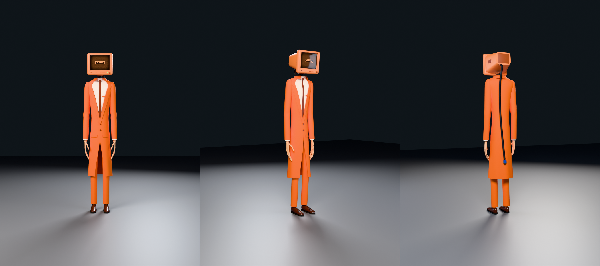

# The Stand-In (floor 2)

The floor-2 monster for REM CYCLE, built from his monster sheet: a very tall, thin man in a
long orange suit, with a boxy 90s CRT monitor where his head should be. The screen shows
static and NO SIGNAL until he picks someone to copy. Then their face comes up on the screen,
his body glitches apart, and he steps out looking exactly like them. Built procedurally in
Blender 5.2 (`bpy`), rigged and animated for Roblox (Idle, Walk, Run).



## Look

- **Build:** 8.75 ft, very thin, with very long legs and long arms. He stands slightly stooped,
  his monitor tipped forward a little.
- **Head:** a chunky orange plastic CRT monitor:
  - a deep bezel and a tapering tube housing behind it, with vents across the top
  - a property sticker on its side: "PROPERTY OF ORANGE COURT, ASSET 2-0417"
  - the Orange Court badge, four buttons and a power button under the screen
  - the green light beside them (he's watching)
- **Screen:** curved CRT glass showing warm static, scanlines and a NO SIGNAL box. It's its
  own part, `Screen`, so the game can put the copied player's headshot on it.
- **No neck:** two thick cables twist up out of his collar into the socket under the monitor.
  A third cable comes out of the back of the monitor and hangs down his back to his knees,
  ending in a blue VGA plug. It's held by three bones, so it can sway as he walks.
- **Suit:** a long single-breasted orange coat down past his knees:
  - notched lapels, two buttons, pocket flaps and a breast pocket
  - parted below the buttons over the trousers
  - a darker lining
  - creased trousers, dark brown dress shoes with laces
- **Shirt and tie:** a cream shirt with a pointed collar, and a narrow dark tie.
- **Hands:** long, thin fingers in a pale peach, curled a little.

The colors are the sheet's palette: suit `#F26810`, lining `#C9521F`, monitor `#FF9055`, dead
screen `#1B0C06`, screen glow `#FFB07A`, shirt `#FFF0E2`, tie and shoes `#7A2D06`, hands
`#F4B88C`.

## Files

| Path | What it is |
|---|---|
| `export/StandIn.fbx` | Rigged model for Roblox's 3D Importer: 7.8 studs tall, origin at the pelvis, textures embedded |
| `export/StandIn_Roblox.blend` | The same 7.8-stud model and rig with the Idle, Walk and Run actions, for exporting the animations with a Roblox plugin |
| `export/StandIn_Idle.fbx`, `_Walk.fbx`, `_Run.fbx` | One animation each, for the Animation Editor's FBX import |
| `export/StandIn.glb` | Same model as glTF, with all three animations |
| `stand_in.blend` | Blender source at real-world size (2.69 m), with rig, weights, materials and animations |
| `renders/animations/` | Preview videos of the three animations |
| `textures/roblox/` | Baked maps for each part's SurfaceAppearance, and the NO SIGNAL screen image |
| `textures/` | The screen, badge and sticker artwork |
| `renders/` | Previews: `studio_*`, `hall_hallway` (in a dark corridor). `rom_sheet.png` is the deformation test |
| `src/` | Scripts that generate all of the above |

## Parts and budget

| MeshPart | Triangles | Roblox setup |
|---|---|---|
| Coat (coat and sleeves) | 9,440 | SurfaceAppearance `standin_coat_*` |
| Trousers | 3,160 | `standin_trousers_*` |
| Shirt (shirt, collar, cuffs, tie) | 752 | `standin_shirt_*` |
| Hands | 2,272 | `standin_hands_*` |
| Shoes | 1,680 | `standin_shoes_*` |
| Monitor | 4,050 | `standin_monitor_*` |
| Cable (neck cables, the hanging cable and its plug) | 1,828 | `standin_cable_*` |
| Screen | 384 | TextureID `screen_nosignal`, Material Neon (or a SurfaceGui) |
| Light | 224 | Neon, green |
| **Total** | **23,790** | |

Each SurfaceAppearance takes the four maps with that prefix: `_color` as ColorMap, `_normal`
as NormalMap, `_roughness` as RoughnessMap and `_metalness` as MetalnessMap. Each mesh is
under 10k triangles and has at most 3 bone weights per vertex.

## Importing into Roblox Studio

1. Open the 3D Importer (**Import 3D**) and choose `export/StandIn.fbx`.
2. **Size:** he's 7.8 studs tall, the same scale as the other monsters (8.75 ft next to a 6 ft
   explorer). Use `Model:ScaleTo()` to adjust, or re-export with another height (see
   Rebuilding).
3. **Standing on the floor:** the rig's root is at the pelvis, 4.0 studs above the floor. If
   his feet don't touch the ground, set the Humanoid's HipHeight. Run this once in the command
   bar with the model selected:

   ```lua
   local m = game.Selection:Get()[1]
   local hum = m:FindFirstChildOfClass("Humanoid")
   local root = hum.RootPart or m:FindFirstChild("HumanoidRootPart")
   local cf, size = m:GetBoundingBox()
   hum.HipHeight = (root.Position.Y - root.Size.Y / 2) - (cf.Position.Y - size.Y / 2)
   print("HipHeight", hum.HipHeight)
   ```
4. **Facing:** he's exported with −Z forward. If he faces away, rotate him 180°.
5. **Textures:** upload the PNGs in `textures/roblox/` and add a SurfaceAppearance to each part
   as in the table above. Leave `Screen` and `Light` without one.

## In the game

- **The screen:** to show a target's face, set the Screen's texture to their headshot.

  ```lua
  local Players = game:GetService("Players")

  local function showFace(standIn: Model, userId: number)
      local ok, image = pcall(Players.GetUserThumbnailAsync, Players, userId,
          Enum.ThumbnailType.HeadShot, Enum.ThumbnailSize.Size420x420)
      if ok then
          (standIn:FindFirstChild("Screen", true) :: MeshPart).TextureID = image
      end
  end
  ```

  Set it back to the `screen_nosignal` asset for the static. For moving static and scanlines
  as on the sheet, put a `SurfaceGui` on the Screen's front face with an `ImageLabel` instead,
  and flip between a few static frames. I haven't been able to test either way in Studio.
- **The light:** it's a separate part, so it can blink or turn off when he isn't watching.
- **The glitch into a copy:** the sheet's plan works with this model as it is. Flicker his
  parts' transparency, offset tinted clones sideways and play a static burst, then swap him
  for an avatar rig built with `Players:GetHumanoidDescriptionFromUserId`.
- **The cable:** `Cable1` → `Cable2` → `Cable3` hang off `UpperTorso`. All three animations
  swing it a beat behind him.

## Animations

All three are in place (the Humanoid does the moving), 30 fps, keyed on every frame, and loop
seamlessly (the last frame equals the first). The legs were solved with IK while animating so
planted feet don't slide, then written out as plain rotation keys, so nothing needs a
constraint or a special exporter. He moves "slow, stooped": a tall man with too-long limbs who
doesn't quite know how to use them.

| Action | Length | Loop | Feel |
|---|---|---|---|
| `Idle` | 120 frames (4 s) | yes | Stooped and still, swaying a little; the monitor drifts and tips as if he's watching you; his long fingers slowly curl and uncurl, one hand then the other |
| `Walk` | 48 frames (1.6 s) | yes | Long, slow, stooped strides; the arms hang and barely swing |
| `Run` | 24 frames (0.8 s) | yes | A lanky lope leaning forward, the arms loose and trailing, never quite in time; the monitor bobs and the cable is flung out behind him |

The cable down his back swings a beat behind his body in all three.

**Matching speed:** the feet are matched to these ground speeds. At other WalkSpeeds, scale
the track speed to match, for example `track:AdjustSpeed(humanoid.WalkSpeed / 14.6)` for the
run.

- **Walk:** 3.3 studs/s
- **Run:** 14.6 studs/s

**Exporting them yourself:** open `export/StandIn_Roblox.blend`. It matches the model you
imported (7.8 studs, origin at the pelvis). Pick an action on `StandIn_Rig` and export it with
your plugin. Only `LowerTorso` has translation keys (the bob and sway); every other bone is
rotation only.

## Rig

40 bones. The limb bones run along the limbs, so they're easy to animate in Blender:

- **Root:** `Root` → `HumanoidRootNode` → `LowerTorso`, all at the pelvis, the bone layout
  Roblox uses for skinned characters.
- **Body:** `LowerTorso` → `UpperTorso` → `Head` (the monitor), and `UpperTorso` →
  `Cable1` → `Cable2` → `Cable3`.
- **Arms:** `UpperTorso` → `Left/RightUpperArm` → `LowerArm` → `Hand` → `Thumb`, `Index`,
  `Middle`, `Ring` and `Pinky`, each `1` and `2`.
- **Legs:** `LowerTorso` → `Left/RightUpperLeg` → `LowerLeg` → `Foot`.

How the parts follow the bones:

- **Sleeves and trousers:** blend across the elbows and knees.
- **Coat:** the skirt follows the thighs a little, so the coat moves when he walks, and the
  shoulders follow the upper arms.
- **Neck cables:** blend from `UpperTorso` into `Head`.
- **Monitor, Screen and Light:** rigid on `Head`.

`renders/rom_sheet.png` shows him taking a stooped step, waving, reaching, crouching and
tilting his head with the cable swinging.

## Rebuilding

Needs `pip install bpy` (Blender as a Python module) and Pillow. The scripts reuse helpers
from `../poster_monster/src` and `../props/src`. Run from `src/`:

```bash
python3 standin_textures.py ../textures                  # the screen, badge and sticker
python3 standin_build.py ../stand_in.blend               # model, rig, weights and baked textures
python3 standin_render.py ../stand_in.blend ../renders   # previews (--look studio|hall, --views ...)
python3 standin_rig_check.py ../stand_in.blend ../renders/rom_sheet.png
python3 standin_animate.py ../stand_in.blend             # keyframe Idle, Walk and Run
python3 standin_export.py ../stand_in.blend ../export    # FBX (model + one per animation), GLB, Roblox .blend and textures/roblox

# from art/: a contact sheet and preview videos of the animations
python3 shared/anim_sheet.py stand_in/stand_in.blend StandIn_Rig sheet.png --target 0,0,1.25 --offset=-5.5,-4.5,0.3
python3 shared/anim_preview.py stand_in/stand_in.blend StandIn_Rig stand_in/renders/animations --target 0,0,1.3 --offset=-5.5,-4.5,0.3 --lens 50 --neutral
```

- **Joints, hands, rig, monitor size and the cable's path:** `standin_common.py`
- **Coat, sleeves, trousers, shirt, hands, shoes, monitor and cables:** `standin_build.py`
- **The animations:** `standin_animate.py`, using the shared tools in `../shared/anim_core.py`
